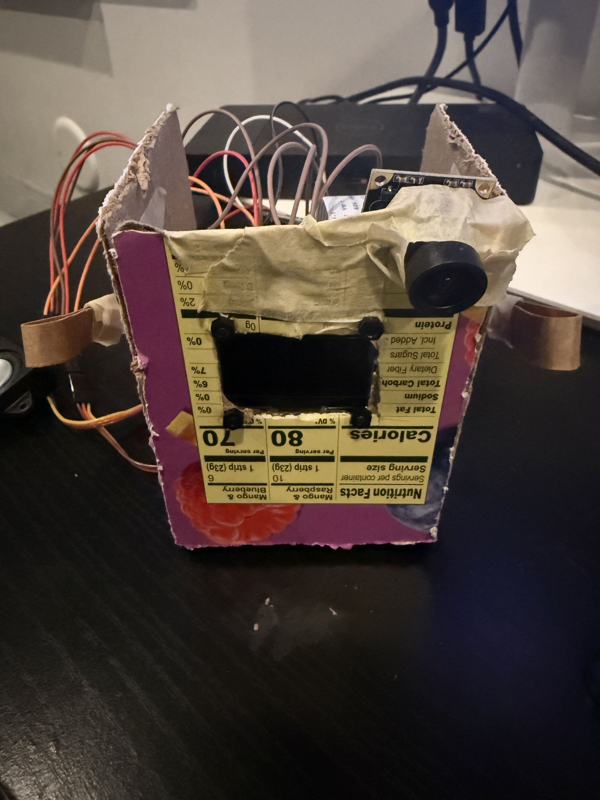
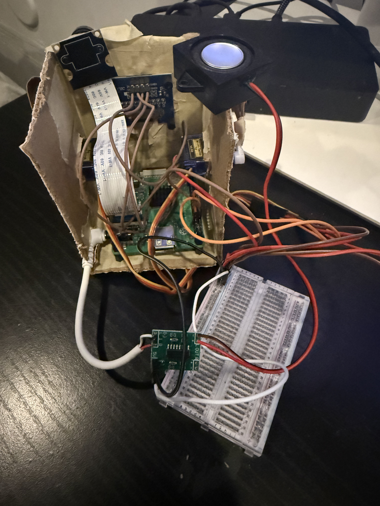

# fruit_box — Raspberry Pi companion robot

fruit_box is a Python desktop robot project combining OLED expressions, two servo arms, USB audio, a CSI camera, local wake-word detection, and Gemini conversation. This repository is a sanitized preparation from the supplied Pi backup, not a newly validated hardware release.

<p align="center">
  
</p>

*fruit_box — current Raspberry Pi robot prototype with a cardboard enclosure.*

## Prototype and demo

The build uses a repurposed fruit box for its prototype enclosure. Audio, camera, and servo operation are owner-confirmed; the photographs document the physical build.

<details>
<summary>Inside the prototype</summary>

<p align="center">
  
</p>

*Interior build overview. This photo documents construction; use the [wiring notes](docs/wiring.md) for connection information and unresolved details.*

</details>

### Earlier voice-conversation demo

This excerpt is transcribed from an earlier terminal screenshot. It shows audio transcription, Gemini responses, emotion parsing, and playback logging. That prototype used the former name **Cosmo** and an Enter trigger; the current public name is **fruit_box** and the code listens for **Hey Jarvis**. The private shell prompt is omitted. No API key appears in this excerpt.

```text
Press Enter to speak...
Listening...
Done listening.
Transcribing...
You said: Tell me something that makes you angry.
Thinking...
Cosmo: I get so mad when fuzzy dust bunnies get stuck in my wheels and stop my exploring! It makes my little gears grind. [ANGRY]
>> Emotion: ANGRY
Playing WAVE 'stdin' : Signed 16 bit Little Endian, Rate 22050 Hz, Mono
```

The response’s reference to wheels is generated character dialogue, not evidence that locomotion is implemented.

## Implementation and evidence

Implemented in `robot.py`: listen locally for **Hey Jarvis**, move arms and acknowledge, record five seconds of mono 16 kHz audio, send audio to Gemini for transcription, then capture a camera image and send the transcription plus image to Gemini. Parse the response's emotion tag, update OLED eyes and mirrored arms, and speak through `espeak` → `aplay`. A background thread blinks every four seconds. The public name and system prompt both use **fruit_box**; the pretrained wake phrase remains **Hey Jarvis**.

The original README identifies a Raspberry Pi 3A+, SH1106 OLED, Plantronics headset, OV5647 camera, and two SG90 arm servos in the development build. The project owner confirms that **audio, camera, and servos are working**. The current robot uses **a USB cable and power brick connected from a wall outlet to the Pi; no batteries are installed**. Adapter specifications and exact power/ground connections still need confirmation. Wake-word reliability and end-to-end operation of this sanitized copy have not been independently tested during preparation. Diagnostic scripts are tools, not new test results.

Planned, with no implementation here: tank locomotion with DRV8833/N20 motors, distance and motion sensing, touch reactions, standalone I2S microphone/amplifier audio, idle movement, mood memory, sleep timeout, background face detection, and final chassis. Battery operation is planned; final power wiring needs confirmation. See [hardware](docs/hardware.md), [wiring](docs/wiring.md), [power](docs/power.md), and [configuration](docs/configuration.md).

## Layout

```text
.
├── robot.py                 # Main program (initializes hardware on execution/import)
├── eye_lib.py               # Pillow drawing primitives
├── expressions.py           # Eye presets; imports eye_lib
├── test_arm_positions.py    # Interactive mirrored arm positioning
├── test_camera.py           # Camera capture
├── test_eyes.py             # Expression sequence
├── test_gemini.py           # Text API + speech
├── test_oled.py             # Continuous OLED animation
├── test_servos.py           # Servo endpoint sequence
├── test_tts.py              # Speech routing
├── test_vision.py           # Camera + vision API
├── test_wakeword.py         # Local microphone/wake-word diagnostic
├── config/README.md         # Reviewed configuration guidance only
├── docs/                   # Hardware, wiring, power, configuration, verification
│   └── images/             # Reviewed prototype photos and demo evidence
├── .env.example            # Credential-free variable reference
├── .gitignore
└── requirements.txt
```

No raw backup, installed packages, private shell/SSH/audio configuration, recordings, camera captures, or unreviewed screenshot is included. Keep scripts in this root so `expressions` and `eye_lib` imports continue to resolve.

## Raspberry Pi setup

The source README identifies Raspberry Pi OS Lite 64-bit and Python 3.13; compatibility of a fresh installation with these unpinned dependencies has not been tested. Use a Python/OS combination supported by the required ARM wheels, especially openWakeWord and its inference runtimes. Do not copy the old installed-package tree into this repository.

On the Pi, from this folder, install OS tools separately from Python dependencies:

```bash
sudo apt update
sudo apt install python3-venv python3-dev build-essential libportaudio2 portaudio19-dev espeak alsa-utils i2c-tools rpicam-apps
sudo raspi-config
```

Enable I2C in `raspi-config`. Camera tool/package availability depends on the Raspberry Pi OS release; confirm `rpicam-still --help` works. The code does not require OpenCV, Whisper, torch, hardware PWM overlays, or the old README's legacy camera boot settings. Do not apply private ALSA/udev/boot files wholesale.

```bash
python3 -m venv .venv
. .venv/bin/activate
python -m pip install -r requirements.txt
```

`requirements.txt` lists direct third-party imports plus the ONNX inference backend, without claiming tested versions. `luma.oled` brings its `luma.core` dependency. If native compilation fails, install the build libraries requested by that package for your OS. Runtime/model wheel availability on the Pi and Python version needs confirmation; do not bypass dependency failures by copying system packages.

### Wake-word models

With the virtual environment active, download the pretrained models and shared feature models into the installed package, outside tracked source:

```bash
python -c 'from openwakeword.utils import download_models; download_models(model_names=["hey_jarvis"])'
python -c 'from pathlib import Path; import openwakeword; print(Path(openwakeword.__file__).parent / "resources" / "models" / "hey_jarvis_v0.1.onnx")'
```

Both wake-word scripts default to that installation-relative ONNX file and explicitly select the ONNX backend. If using another location, export `WAKEWORD_MODEL_PATH` to the actual file. The shared feature models must also be available to the installed library; downloading only the wake-word classifier is insufficient. No models or installed packages are committed. Review upstream model licensing before redistribution or commercial use. These instructions follow the [upstream download utility](https://github.com/dscripka/openWakeWord/blob/main/openwakeword/utils.py) and [model API](https://github.com/dscripka/openWakeWord/blob/main/openwakeword/model.py); installation and inference still require Pi testing.

## Configuration and launch

The program **does not load `.env` files**. `.env.example` is a reference, not an automatically loaded configuration. In the same shell that launches Python, enter your key without putting its literal value in a shell-history command:

```bash
read -r -s -p 'Gemini API key: ' GEMINI_API_KEY; printf '\n'
export GEMINI_API_KEY
# Optional override; choose an available model with audio and image input support:
export GEMINI_MODEL='gemini-3.5-flash'
```

The prompt command above is for Bash on the Pi. A missing/empty key stops all three Gemini scripts with a clear message. The inherited default model ID is `gemini-3.5-flash`; its existence, permissions, and modality support **Need confirmation** with your account. No API call was made during preparation. Check current provider billing and limits; no free-tier quota or zero-cost promise is made here.

Before launch, follow [configuration](docs/configuration.md) to identify microphone and speaker devices, verify the model file, and review servo travel and power. GPIO uses BCM numbering and `RPi.GPIO.PWM` **software PWM** at 50 Hz, even on GPIO12/13.

```bash
python robot.py
```

Launch from the repository root. Say **Hey Jarvis**, wait for the acknowledgement, then speak during the five-second recording window. Ctrl+C in the main loop requests shutdown, including arm movement to the SAD pose. Startup and shutdown can move servos. The script initializes hardware at module level: do not import it as a library or run automated test discovery against these diagnostics.

## Diagnostics

Run one script at a time from the repository root with the virtual environment active. These are manual hardware diagnostics, not a pytest suite. Inspect motion ranges and confirm wiring/power first. Stop continuous scripts with Ctrl+C; cleanup is incomplete in some scripts.

| Command | Action / requirements | Servo movement | Gemini/API use |
|---|---|---|---|
| `python test_oled.py` | Continuous SH1106 open/blink animation over I2C | No | No |
| `python test_eyes.py` | SH1106 preset expression sequence | No | No |
| `python test_servos.py` | Both arms at 0°, 90°, 180°, 0°; not mirrored like main program | **Yes; endpoints** | No |
| `python test_arm_positions.py` | Interactive left angle; right = 180 − left; enter only 0–180 (not enforced) | **Yes** | No |
| `python test_camera.py` | Runs rpicam-still; writes `capture.jpg` | No | No |
| `python test_tts.py` | Says a fixed phrase using espeak/aplay, ALSA card 1 | No | No |
| `python test_wakeword.py` | Streams microphone index 1; prints local detection scores | No | No |
| `python test_gemini.py` | Sends a fixed math question and speaks reply, ALSA card 1 | No | **Yes; may incur charges** |
| `python test_vision.py` | Captures `capture.jpg`, prompts for question, uploads image/question | No | **Yes; may incur charges** |

`robot.py` moves servos, uses camera/microphone and calls Gemini (normally transcription plus response requests per accepted interaction). Audio is sent to Gemini for transcription; images and transcribed text are sent for responses. Local wake-word listening does not itself call Gemini. Conversations/responses are printed to the terminal. The latest camera image remains locally; temporary WAV files are normally deleted after successful transcription but can remain after errors. Avoid recording people or surroundings without appropriate consent.
